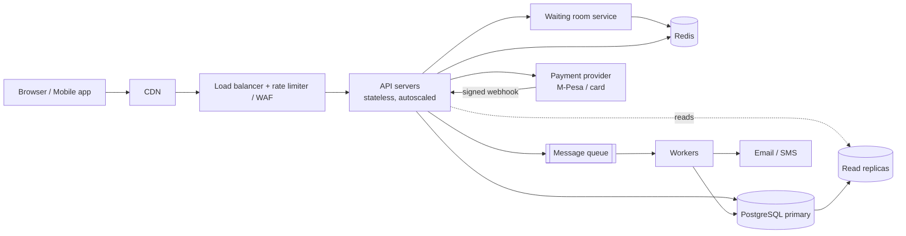

# TicketHub: System Design

TicketHub is a website that sells tickets for concerts and events. This document follows the six-part framework: requirements, estimates, API, data model, architecture, and trade-offs. It also explains in detail how the system guarantees that **two people can never buy the same seat**.

**Given facts**

- 2 million registered users
- 50,000 visitors on a normal day, each viewing 10 pages
- 5,000 tickets sold on a normal day
- Big sale: 200,000 people try to buy 20,000 seats within the first 10 minutes

---

## 1. Requirements

### Functional requirements

1. A visitor can browse and search events by name, city, date and category.
2. A visitor can view an event page and a seat map showing which seats are available.
3. A registered user can sign up, log in and log out.
4. A logged-in user can select seats and **hold** them for a limited time (5 minutes) while they pay.
5. A user can pay for held seats (card or mobile money, e.g. M-Pesa).
6. After payment, the user receives tickets (in the app and by email/SMS) and can view "My tickets" at any time.
7. A user can release a hold, and held seats are released automatically when the hold expires.
8. If payment fails or the hold expires, the seats return to the pool.
9. Organizers/admins can create events and set seat layouts and prices (out of scope for the detailed design below).

### Non-functional requirements

| Area | Requirement | Target |
|---|---|---|
| **Speed** | Browsing and seat-map pages feel instant | p95 < 300 ms for reads, p95 < 500 ms for hold requests, even during a big sale |
| **Correctness** | A seat is never sold to more than one person | Zero double-bookings. This is a hard guarantee, not a "best effort" |
| **Correctness** | No money taken without a ticket, no ticket without money | Payments are idempotent; failed or late payments are refunded automatically |
| **Fairness** | First come, first served; no unfair advantage for bots or people with faster connections | Virtual waiting room with randomized entry for the first minutes, per-user ticket limit (4), rate limiting and bot protection |
| **Availability** | Site stays up during the big sale | 99.9% overall; the sale may be slowed by queues but must not crash |
| **Scalability** | Handle roughly 1,000x normal read traffic for a short burst | Autoscaling stateless servers, CDN and cache for reads |
| **Durability** | Paid tickets are never lost | Data replicated; backups; the database is the source of truth |
| **Security** | Protect accounts and payments | HTTPS, hashed passwords, no card data stored by us (payment provider handles it) |

**Priority when requirements conflict:** correctness first, then fairness, then speed. It is acceptable to make a user wait in a queue; it is never acceptable to sell the same seat twice.

---

## 2. Estimates

### Normal day

| Quantity | Calculation | Result |
|---|---|---|
| Page views per day | 50,000 visitors x 10 pages | 500,000 |
| Average page-view rate | 500,000 / 86,400 s | about 6 requests/s |
| Peak (assume 10x average, evenings) | 6 x 10 | about 60 requests/s |
| Tickets sold per day | given | 5,000 |
| Average purchase rate | 5,000 / 86,400 s | about 0.06 purchases/s (peak about 1/s) |
| Read-to-write ratio | 500,000 views : 5,000 sales | about 100 : 1 (read-heavy) |
| New ticket data per year | 5,000 x 365 = 1.8M rows x about 200 bytes | about 0.4 GB/year (tiny) |

A single small database and two app servers could handle a normal day. Storage is not a concern; **traffic bursts are**.

### Big sale (popular concert goes on sale)

Assumptions: each of the 200,000 users makes about 20 requests in the first 10 minutes (open event page, reload the seat map about 10 times, 2-3 hold attempts, payment and status checks).

| Quantity | Calculation | Result |
|---|---|---|
| Users in the window | given | 200,000 in 600 s, about 333 arrivals/s on average. If 60% arrive in the first minute, that minute averages about 2,000 arrivals/s. |
| Requests in the window | 200,000 x 20 | 4,000,000 |
| Average request rate | 4,000,000 / 600 s | about 6,700 requests/s |
| Peak request rate (2x burst headroom) | 6,700 x 2 | **about 13,000 requests/s** (design target) |
| Seat-map reads | about 10 of the 20 requests per user | about 50% of all traffic |
| Hold attempts | 200,000 users x about 3 | about 600,000, or about 1,000/s average and 2,000/s at the peak |
| Successful holds | cannot exceed seats | at most 20,000 (plus re-holds of expired seats) |
| Competition | 200,000 users / 20,000 seats | **10 people per seat**; 90% of users will not get a ticket |
| Sales rate | if it sells out in about 2-3 minutes | about 100-170 purchases/s at the peak (33/s if spread over 10 minutes) |
| Seat-map size | 20,000 seats x 1 byte status | about 20 KB per map (about 5 KB compressed): very cacheable |

### Comparison: normal vs. big sale

| Metric | Normal day | Big sale | Factor |
|---|---|---|---|
| Request rate | about 6/s (peak 60/s) | about 6,700/s (peak 13,000/s) | **about 1,000x average, 200x vs. normal peak** |
| Purchases per second | 0.06 (peak about 1) | 33 average, 100-170 peak | **about 500x to 2,000x** |
| Unique users | 50,000 in 24 hours | 200,000 in 10 minutes | 4x a whole day's visitors in 1/144 of the time |
| Tickets sold | 5,000 in 24 hours | 20,000 in about 3-10 minutes | 4x a whole day's sales in minutes |
| Shape of traffic | smooth, read-heavy | a vertical spike, with heavy contention on a small set of rows (the 20,000 seats) | |

**Takeaways**

1. The system must be sized for the spike, not the average, so it uses autoscaling plus a queue to flatten the spike.
2. Most of the spike is reads (seat maps), which can be cached; the hard part is the small number of conflicting writes on the same seats.
3. The real database workload is modest (about 100-200 writes/s at the peak) as long as we stop 200,000 people from hitting it at once.

---

## 3. API

REST over HTTPS, JSON bodies. Authenticated endpoints use `Authorization: Bearer <token>`. State-changing endpoints accept an `Idempotency-Key` header so a retry never creates a duplicate.

| # | Method and path | Purpose | Auth |
|---|---|---|---|
| 1 | `GET /events?query=&city=&date=&category=&page=` | Browse and search events (paginated) | No |
| 2 | `GET /events/{event_id}` | Event details: title, venue, date, price tiers, sale status | No |
| 3 | `GET /events/{event_id}/seats?section=` | View seats and their status (`AVAILABLE`, `HELD`, `SOLD`) | No |
| 4 | `POST /events/{event_id}/queue` | Join the virtual waiting room during a big sale; returns a queue token | Yes |
| 5 | `GET /events/{event_id}/queue/status` | Check position or admission; returns an admission pass when allowed in | Yes |
| 6 | `POST /events/{event_id}/holds` | **Hold** seats for 5 minutes | Yes |
| 7 | `DELETE /holds/{order_id}` | Release a hold early | Yes |
| 8 | `POST /orders/{order_id}/payments` | Start payment for held seats | Yes |
| 9 | `POST /webhooks/payments` | Callback from the payment provider (signed) | Provider signature |
| 10 | `GET /orders/{order_id}` | Order and payment status | Yes |
| 11 | `GET /me/tickets` | View my tickets | Yes |
| 12 | `POST /auth/register`, `POST /auth/login` | Account creation and login | No |

### Key examples

**Hold seats**

```http
POST /events/42/holds
Authorization: Bearer <token>
Idempotency-Key: 7b1f0c52-3d0e-4e4b-9a55-2f6f1c8a9d11
X-Admission-Pass: <pass from the waiting room>

{ "seat_ids": [1015, 1016, 1017] }
```

Success `201 Created`:

```json
{
  "order_id": 98123,
  "status": "PENDING",
  "seat_ids": [1015, 1016, 1017],
  "expires_at": "2026-11-05T18:05:00Z",
  "total": 7500.00,
  "currency": "KES"
}
```

Failure `409 Conflict` (all-or-nothing, so no partial holds):

```json
{ "error": "SEATS_UNAVAILABLE", "unavailable_seat_ids": [1016] }
```

Other errors: `400` (more than 4 seats), `401` (not logged in), `403` (no admission pass), `429` (rate limited).

**Pay**

```http
POST /orders/98123/payments
Idempotency-Key: 5a9e...

{ "method": "MPESA", "phone": "2547XXXXXXXX" }
```

Response `202 Accepted`: `{ "payment_id": 5541, "status": "PENDING" }`. The final result arrives through the webhook, and the client polls `GET /orders/98123` (or receives a push update).

**My tickets**

```http
GET /me/tickets
```

```json
{ "tickets": [ { "ticket_id": 7731, "event": "Sauti Live Nairobi", "seat": "Block A, Row 4, Seat 12", "qr_code": "..." } ] }
```

---

## 4. Data model

PostgreSQL (relational database). Seven tables:

```text
users 1 ──< orders 1 ──< tickets >── 1 event_seats >── 1 events >── 1 venues
                │
                └──< payments
```

### Tables

**users**

| Column | Type | Notes |
|---|---|---|
| id | BIGINT PK | |
| email | TEXT | `UNIQUE NOT NULL` |
| phone | TEXT | |
| password_hash | TEXT | never store plain passwords |
| name | TEXT | |
| created_at | TIMESTAMPTZ | |

**venues**

| Column | Type | Notes |
|---|---|---|
| id | BIGINT PK | |
| name, city | TEXT | |
| capacity | INT | |

**events**

| Column | Type | Notes |
|---|---|---|
| id | BIGINT PK | |
| venue_id | BIGINT FK to venues.id | |
| title, category | TEXT | |
| starts_at | TIMESTAMPTZ | |
| sale_starts_at | TIMESTAMPTZ | when tickets go on sale |
| max_tickets_per_user | INT | default 4 |
| status | TEXT | `DRAFT / ON_SALE / SOLD_OUT / CANCELLED` |

**event_seats** (one row per seat per event: this is the row everyone fights over)

| Column | Type | Notes |
|---|---|---|
| id | BIGINT PK | |
| event_id | BIGINT FK to events.id | |
| section, row_label, seat_number | TEXT / INT | `UNIQUE (event_id, section, row_label, seat_number)` |
| price | NUMERIC(10,2) | `CHECK (price >= 0)` |
| status | TEXT | `AVAILABLE / HELD / SOLD`, with `CHECK (status IN (...))` |
| held_by_order_id | BIGINT FK to orders.id, NULL | set while HELD |
| hold_expires_at | TIMESTAMPTZ, NULL | |
| version | INT | optional optimistic-lock counter |

Index: `(event_id, status)` for fast seat-map queries.

**orders**

| Column | Type | Notes |
|---|---|---|
| id | BIGINT PK | |
| user_id | BIGINT FK to users.id | |
| event_id | BIGINT FK to events.id | |
| status | TEXT | `PENDING / PAID / EXPIRED / CANCELLED / REFUNDED` |
| total | NUMERIC(10,2) | |
| idempotency_key | TEXT | `UNIQUE (user_id, idempotency_key)`, so a retry returns the same order |
| created_at, expires_at | TIMESTAMPTZ | |

**tickets** (created only when payment succeeds)

| Column | Type | Notes |
|---|---|---|
| id | BIGINT PK | |
| order_id | BIGINT FK to orders.id | |
| event_seat_id | BIGINT FK to event_seats.id | **`UNIQUE`: one ticket per seat, ever** |
| qr_code | TEXT | `UNIQUE` |
| issued_at | TIMESTAMPTZ | |

**payments**

| Column | Type | Notes |
|---|---|---|
| id | BIGINT PK | |
| order_id | BIGINT FK to orders.id | |
| provider, provider_ref | TEXT | `UNIQUE (provider, provider_ref)`, so a duplicate webhook is ignored |
| amount | NUMERIC(10,2) | |
| status | TEXT | `PENDING / SUCCEEDED / FAILED / REFUNDED` |
| created_at | TIMESTAMPTZ | |

### Relationships

- A **venue** has many **events**; an **event** has many **event_seats** (one per seat for that event).
- A **user** has many **orders**; an **order** has many **tickets** (one per seat) and one or more **payments** (a retry after a failure creates a new payment).
- A **ticket** points to exactly one **event_seat**, and each event_seat can have at most one ticket (unique constraint).

---

## 5. How double-booking is prevented

The scenario: Amina and Brian both click seat A12 at the same millisecond. Only one may get it. We do not trust the front end, the cache or the application code to enforce this. **The database enforces it**, using three layers.

### Layer 1: an atomic conditional update inside a transaction (the hold)

```sql
BEGIN;

-- Create the PENDING order first in this same transaction.
-- Process requested seat IDs in sorted order to reduce deadlock risk.
UPDATE event_seats
SET    status = 'HELD',
       held_by_order_id = :order_id,
       hold_expires_at  = now() + interval '5 minutes'
WHERE  id = ANY(:seat_ids)
  AND  event_id = :event_id
  AND  (status = 'AVAILABLE'
        OR (status = 'HELD' AND hold_expires_at <= now()));

-- Compare the affected-row count with the number of DISTINCT requested seat IDs.
-- If they differ, ROLLBACK the entire transaction and return 409 SEATS_UNAVAILABLE.
-- Validate 1-4 distinct seats for this event before committing.
COMMIT;
```

Why this works:

- **The check and the change are one statement.** There is no gap between "is it free?" and "take it" where another request could sneak in (the classic read-then-write race).
- **Row locks serialize competitors.** When Amina's and Brian's transactions both update row A12, PostgreSQL makes one wait for the other. The first sets `HELD`. When the second continues, it re-checks the `WHERE` clause, sees `status = 'HELD'` with a future expiry, matches 0 rows, and gets a `409`.
- **All-or-nothing.** If a user asks for 3 seats and only 2 were free, the transaction rolls back, so nobody is left holding half an order.
- **Expired holds are reusable** in the same statement, so a crashed or abandoned checkout never blocks a seat forever (a background job also resets them).

### Layer 2: re-check at payment time (the sale)

When a signed payment webhook reports success, verify the provider reference and amount/currency, then reconcile the payment and order in one database transaction. A simplified outline is:

```sql
BEGIN;

-- Lock the order first so duplicate webhooks and expiry workers serialize.
SELECT id, status, expires_at
FROM orders
WHERE id = :order_id
FOR UPDATE;

-- If this provider payment reference was already processed, return the
-- previously recorded result (idempotent replay).
-- If the order is eligible and every seat is still held by this order:
UPDATE event_seats
SET status = 'SOLD',
    hold_expires_at = NULL
WHERE held_by_order_id = :order_id
  AND status = 'HELD'
  AND hold_expires_at > now();

-- Confirm the affected-row count equals the order's seat count.
-- If not, roll back ticket issuance and enqueue a refund.
-- Otherwise insert one ticket per seat, mark the order PAID, and record the
-- provider payment as SUCCEEDED before COMMIT.
COMMIT;
```

The pseudocode omits application-specific SQL for counting the order's seats and recording the payment. In production, all those writes must be in the same transaction, and the code must not commit unless every expected seat was transitioned. If the hold expired or another buyer obtained a seat, the purchase cannot be completed: record the successful provider payment, schedule an idempotent refund, and notify the customer. Write a durable job/outbox record before commit so a worker can retry refunds or notifications after a crash.

### Layer 3: a constraint as the final safety net

`tickets.event_seat_id` is `UNIQUE`. Even if a bug in our code ever tried to issue a second ticket for the same seat, the database would reject the insert and the transaction would fail. The rule "one seat, one ticket" is enforced by the data itself, not by developer discipline.

### Supporting measures

- **Idempotency keys** (`orders.idempotency_key`, `payments.provider_ref` unique) mean double-clicks, network retries and duplicate webhooks create no duplicates.
- **Isolation level:** `READ COMMITTED` with row-level locks (the conditional `UPDATE`) is sufficient and fast; we do not need `SERIALIZABLE` for this access pattern.
- **The cache never decides.** The seat map shown to users may be 1-2 seconds stale, but it is only a hint. The hold request always goes to the database, so a stale map can cause a polite `409`, never a double sale.
- **Consistent seat ordering** when locking multiple seats prevents two users who select overlapping seats from deadlocking.

---

## 6. Architecture



### Components

| Component | What it does | Why it is there |
|---|---|---|
| **CDN** | Serves static assets (images, JS, CSS) and caches event pages and seat-map snapshots for 1-2 seconds | Absorbs the bulk of read traffic; thousands of users refreshing the seat map hit the CDN, not our servers |
| **Load balancer + rate limiter / WAF** | Spreads requests across servers; limits requests per user/IP; blocks bots | Fairness (no scripts hammering the API) and protection against overload |
| **API servers (stateless)** | Run the business logic for the endpoints above | Stateless means we can add or remove servers automatically as traffic rises or falls |
| **Waiting room service** | Puts users arriving at a big sale into a queue, randomizes the order of those who arrive in the first minute, and admits them in controlled batches with a signed admission pass | Turns a vertical spike into a steady flow the database can handle, and is fair |
| **Redis** | Stores queue state, admission passes, rate-limit counters, and the cached seat-status bitmap | Very fast in-memory reads; keeps hot, short-lived data away from the database. It is **not** the source of truth |
| **PostgreSQL primary** | Stores all data; runs the transactions that hold and sell seats | The single authority for seat state, which gives strong consistency and the guarantees in section 5 |
| **Read replicas** | Serve event search, event details and "my tickets" | Moves reads away from the primary so it can focus on seat writes |
| **Message queue + workers** | Run background jobs: release expired holds, issue tickets, send email/SMS, process refunds, retry failed work | Keeps slow work out of the request path so users get quick responses |
| **Payment provider** | Charges the user (M-Pesa STK push or card) and calls our webhook | We never handle raw card data; the webhook is signed and verified, and is idempotent |

### How it survives the big sale

1. **Before the sale:** the event page and static content are pre-warmed in the CDN; extra API servers are pre-scaled; the event is flagged "waiting room on".
2. **Arrival spike (about 2,000 arrivals/s):** the CDN and load balancer take the hit. Users join the waiting room. Everyone who arrives in the first minute gets a random position, so being fast on the keyboard does not matter (fairness).
3. **Controlled admission:** the waiting room lets in only as many shoppers as the database can comfortably serve (for example about 5,000 active at a time, roughly 300 hold attempts/s). The other 195,000 see a "you are in line" page that costs almost nothing to serve.
4. **Seat map polling (about 50% of traffic):** served from the CDN/Redis snapshot, refreshed every 1-2 seconds. The 20,000-seat map is about 5 KB compressed, so even 100,000 refreshes per second is cheap.
5. **Holds:** each admitted user's hold is a short, indexed, row-level transaction. At about 100-200 successful holds per second at the peak, one PostgreSQL primary handles this easily.
6. **Payments:** processed asynchronously through the provider; slow payment calls never block seat transactions.
7. **Limits:** a maximum of 4 tickets per user and one active hold per user stop hoarding; holds expire after 5 minutes so abandoned seats return to the pool.
8. **Failure handling:** if an API server dies, the load balancer routes around it (stateless). If Redis is lost, the database is still correct (we only lose queue positions and cache). If a worker crashes, the queue retries the job.
9. **After the sale:** when seats reach zero, the status flips to `SOLD_OUT`, the event page is served from the CDN as "Sold out", and the system scales back down.

---

## 7. Trade-offs

### Trade-off 1: Holding seats (reservation) vs. buying instantly

- **Chosen:** hold seats for 5 minutes, then pay.
- **Benefit:** users do not pay for a seat only to discover someone else got it; the experience is fair and clear. Payment (especially M-Pesa) takes time, and a hold protects the seat during it.
- **Cost:** some seats are temporarily locked by people who never finish paying, so the event looks sold out when it is not, and the extra `HELD` state adds complexity (expiry jobs, late payments).
- **Mitigation:** short 5-minute holds, a 4-seat limit, automatic release, and showing "held" seats as "may become available".

### Trade-off 2: Strong consistency in one PostgreSQL primary vs. a faster, distributed, eventually consistent store

- **Chosen:** one primary database is the single authority for seat state.
- **Benefit:** transactions and constraints give an absolute guarantee against double-booking, and the design is simple to reason about, test and operate.
- **Cost:** writes are limited by one machine, so we cannot scale seat updates infinitely. Our estimate (about 100-200 writes/s) is far below that limit, but a global stadium tour with millions of simultaneous buyers would need sharding by event.
- **Mitigation:** the waiting room limits write pressure; reads go to replicas and the cache; if needed, shard by `event_id` (each event's seats stay on one shard so transactions remain local).

### Trade-off 3: Virtual waiting room vs. letting everyone in at once

- **Chosen:** queue users and admit them in batches during big sales.
- **Benefit:** protects the system from overload and gives a fair, randomized order.
- **Cost:** most users wait (and 90% still will not get a ticket), and there is an extra component to build and operate. A badly explained queue frustrates people.
- **Mitigation:** clear position and estimated-wait messages; the queue is only enabled for events expected to have heavy demand.

### Trade-off 4: Cached (slightly stale) seat map vs. a live seat map

- **Chosen:** serve the seat map from the CDN/Redis, refreshed every 1-2 seconds.
- **Benefit:** this removes about half of the traffic from the database and keeps pages fast.
- **Cost:** a user may click a seat that was just taken and receive a `409`.
- **Mitigation:** the database is always the authority; the client refreshes and highlights what changed, and the error message suggests nearby seats.

---

## Summary

TicketHub is read-heavy on normal days (about 6 requests/s) and becomes a roughly 1,000x spike during a big sale (about 6,700 requests/s on average, 13,000 at the peak). The design absorbs the spike with a CDN, cache and stateless autoscaled servers, flattens it with a fair waiting room, and keeps the correctness-critical part small: a single PostgreSQL database that uses atomic conditional updates, transactions and a unique constraint so that **no seat can ever be sold twice**.


---

## 8. Acceptance tests and operational checks

These tests make the important guarantees verifiable instead of leaving them as design claims.

| # | Scenario | Expected result |
|---|---|---|
| 1 | Two users request the same available seat at nearly the same time | Exactly one hold succeeds; the other receives `409 SEATS_UNAVAILABLE`. |
| 2 | A user requests three seats but one is already held by another user | The transaction rolls back; the user receives no partial hold. |
| 3 | The same hold request is retried with the same idempotency key | The original order/result is returned; no second hold or order is created. |
| 4 | A hold expires without payment | The expiry worker releases it, and a new user can hold it. |
| 5 | A payment provider sends the same successful webhook twice | The second delivery is an idempotent no-op; only one ticket per seat exists. |
| 6 | A successful payment arrives after the hold expired and the seat was resold | No ticket is issued for the old order; a refund job is recorded and retried safely. |
| 7 | The provider sends an invalid signature or mismatched amount/currency | Reject or quarantine the event; do not mark the order paid or issue tickets. |
| 8 | A user tries to hold more than four seats or seats from another event | Reject the request before committing any hold. |
| 9 | The queue/cache is unavailable during a sale | PostgreSQL remains the source of truth; no seat is sold based on cache state. |
| 10 | A worker crashes while sending tickets or processing a refund | The durable job is retried; idempotency prevents duplicate tickets or refunds. |

### Metrics and alerts

Track request rate and latency by endpoint (especially p95/p99 for hold requests), queue length and wait time, hold conflicts, expired holds, database lock waits, payment webhook failures, refund backlog, and ticket-issuance failures. Alert on a rising error rate, queue growth beyond the planned limit, or any mismatch between successful payments and issued tickets. Logs should include request/order/payment IDs but must not include passwords, full payment credentials, or authentication tokens.
