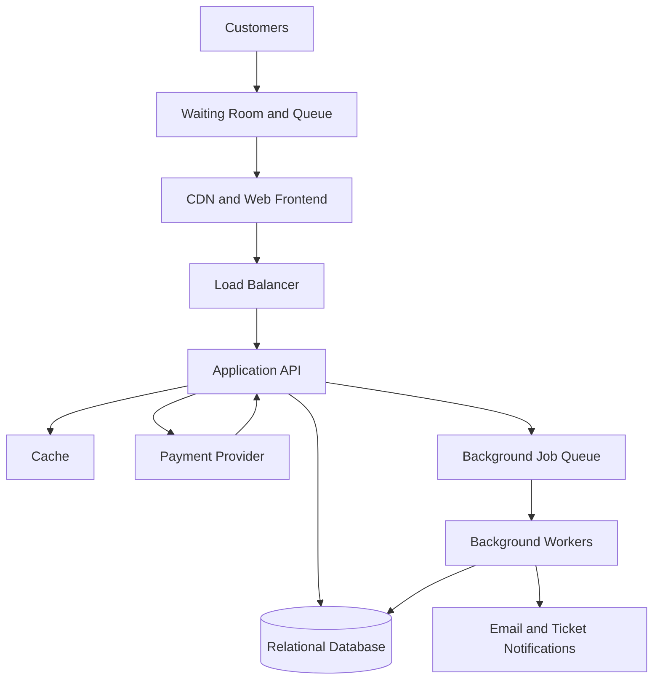

# TicketHub — Event Ticketing System Design

## 1. Requirements

### Functional requirements

- Users can register, sign in, and manage their accounts.
- Users can browse, search, and view events.
- Users can view seats, prices, and seat availability.
- Users can temporarily hold an available seat during checkout.
- Users can pay for tickets and receive booking confirmations.
- Users can view their purchased tickets.
- Event administrators can create events and manage seating.
- Expired or abandoned seat holds are released automatically.

### Non-functional requirements

- **Speed:** Event pages should normally load within 2 seconds.
- **Correctness:** A seat must never be sold to two customers.
- **Fairness:** A waiting room and queue control access during popular sales.
- **Availability:** Browsing should remain available during high demand.
- **Security:** Users can access only their own orders and tickets.
- **Scalability:** The system supports 2 million registered users and sudden traffic spikes.
- **Reliability:** Failed payments must not result in confirmed tickets, and retries must not create duplicate orders.

## 2. Traffic Estimates

### Normal-day traffic

Given:
- Registered users: 2,000,000
- Daily visitors: 50,000
- Pages per visitor: 10
- Tickets sold per day: 5,000

Daily page views:

50,000 × 10 = 500,000 page views per day.

Average page views per second:

500,000 ÷ 86,400 = approximately 5.8 requests per second.

Assuming normal peak traffic is 10 times the daily average:

5.8 × 10 = approximately 58 requests per second.

The 10-times multiplier is a planning assumption, not a measured value.

### Popular concert sale

Given:
- 200,000 people attempt to buy tickets in 10 minutes.
- 20,000 seats are available.
- 10 minutes = 600 seconds.

Average purchase attempts per second:

200,000 ÷ 600 = approximately 333 attempts per second.

Assuming each person makes three API requests during the purchase process:

333 × 3 = approximately 999 requests per second.

This is an estimate. Actual demand may arrive in a shorter burst, so load testing is necessary.

Demand compared with supply:

200,000 ÷ 20,000 = 10 people competing for each seat.

Only 10% of interested buyers can obtain a seat if all seats sell out.

### Comparison

The estimated normal peak is 58 requests per second, while the big sale could generate about 999 requests per second under the three-request assumption. This is approximately 17 times the estimated normal peak.

A waiting room, caching, rate limiting, and controlled database access help manage this increase.

## 3. API Design

The API uses HTTPS and JSON. Protected endpoints require authentication.

| Method and endpoint | Purpose |
|---|---|
| GET /events | Browse and search events |
| GET /events/{eventId} | View event details |
| GET /events/{eventId}/seats | View seat availability |
| POST /events/{eventId}/holds | Temporarily hold a seat |
| DELETE /holds/{holdId} | Release a hold |
| POST /orders | Create an order from a valid hold |
| POST /orders/{orderId}/payment | Initiate payment |
| GET /me/tickets | View purchased tickets |
| GET /me/orders/{orderId} | View an order |

### Holding a seat

A customer sends a seat ID to the hold endpoint. The server checks availability and attempts to hold the seat atomically.

If successful, the response contains a hold ID and expiry time. If another customer has already held or purchased the seat, the server returns HTTP 409 Conflict.

### Payment

The payment endpoint checks the order and hold, then communicates with a trusted payment provider.

An idempotency key prevents repeated requests from creating duplicate charges. The system confirms an order only after verifying successful payment and ensuring the reservation is still valid.

## 4. Data Model

The system uses a relational database with primary keys, foreign keys, and constraints.

### Users

| Column | Purpose |
|---|---|
| user_id (PK) | Unique user ID |
| name | User's name |
| email (UNIQUE) | Unique email address |
| password_hash | Secure password hash |
| created_at | Account creation time |

### Events

| Column | Purpose |
|---|---|
| event_id (PK) | Unique event ID |
| title | Event name |
| venue | Event location |
| starts_at | Event date and time |
| status | Draft, published, or cancelled |

### Seats

| Column | Purpose |
|---|---|
| seat_id (PK) | Unique seat ID |
| event_id (FK) | Related event |
| seat_label | Seat number or label |
| price | Ticket price |
| status | Available, held, or sold |
| held_by_user_id (FK, nullable) | User holding the seat |
| hold_expires_at (nullable) | Hold expiry time |

A UNIQUE constraint on (event_id, seat_label) prevents duplicate seat definitions within an event.

### Orders

| Column | Purpose |
|---|---|
| order_id (PK) | Unique order ID |
| user_id (FK) | Customer |
| status | Pending, confirmed, failed, or cancelled |
| total_amount | Order total |
| payment_reference | Payment provider reference |
| created_at | Order creation time |

### Order_Items

| Column | Purpose |
|---|---|
| order_item_id (PK) | Unique order line |
| order_id (FK) | Related order |
| seat_id (FK) | Purchased seat |
| price_at_purchase | Recorded purchase price |

A UNIQUE constraint on seat_id prevents the same seat from appearing in multiple order items. Cancelled or expired reservations must be handled so that only one active or confirmed booking exists for each seat.

### Relationships

- One user can have many orders.
- One event has many seats.
- One order can contain many order items.
- Each order item refers to one seat.
- Each seat can be held by one customer at a time and sold only once.

## 5. Preventing Double-Booking

The most important rule is that two customers must never purchase the same seat.

### Step 1: Atomic seat holds

When a customer requests a seat, the server begins a database transaction and locks the seat row. It checks whether the seat is available or whether an earlier hold has expired.

If available, the server updates the seat to held, records the customer, and sets an expiry time, such as five minutes. It commits the transaction.

A simultaneous request must wait for the lock or find that the seat is no longer available. Only one customer can successfully hold the seat.

### Step 2: Database constraints

Application checks alone are insufficient because two requests can arrive at nearly the same time.

Database constraints provide an additional safeguard against duplicate seat definitions and duplicate bookings. If a constraint is violated, the server rejects the booking and returns a conflict response.

### Step 3: Safe payment confirmation

Before confirming an order, the server verifies that the hold belongs to the customer and is still valid.

Seat and order changes are performed transactionally. The system does not keep a database transaction open while waiting for an external payment provider.

Instead, it tracks pending payments, verifies provider callbacks, and processes them idempotently. If payment fails or the reservation expires, the order is not confirmed and the seat is released safely. A late successful payment that cannot be fulfilled must trigger a refund or an exception-handling process.

### Step 4: Expiring abandoned holds

A background worker identifies expired holds and releases them using a conditional update. It verifies the current hold and expiry time before releasing the seat, avoiding accidental release of a renewed hold.

**Result:** Row-level locks serialize competing hold requests, database constraints provide a final safeguard, and transactions keep booking changes consistent.

## 6. Architecture

### Component explanations

1. **Customers:** Browse events, select seats, and make purchases.
2. **Waiting room and queue:** Controls entry to checkout during high-demand sales and reduces overload.
3. **CDN and frontend:** Serves website files and public event information efficiently.
4. **Load balancer:** Distributes requests across multiple application instances.
5. **Application API:** Authenticates users, manages holds and orders, and coordinates payments.
6. **Cache:** Stores frequently requested public event data. Booking decisions use the authoritative database.
7. **Relational database:** Stores users, events, seats, and orders. Transactions, locks, and constraints protect correctness.
8. **Payment provider:** Processes payments and reports payment status.
9. **Background queue and workers:** Handle expired holds, retries, and other tasks outside the main request path.
10. **Notifications:** Sends ticket confirmations after successful purchases.

### Surviving the big sale

The waiting room limits the number of customers reaching checkout simultaneously. The CDN and cache reduce repeated requests to the application. Multiple API instances handle incoming traffic, while controlled database concurrency protects the booking process.

The system should be load-tested for traffic bursts, database contention, and payment delays. Monitoring should track response times, queue length, failed bookings, and database performance. If demand exceeds capacity, the system should slow admissions and provide clear waiting messages instead of risking incorrect bookings.

## 7. Trade-offs

### Trade-off 1: Consistency versus speed

Database transactions and row-level locks protect seat correctness, but competing requests may wait and increase checkout latency.

**Decision:** Correctness takes priority over accepting every request immediately. A queue controls concurrency, and caching is used for public information.

### Trade-off 2: Fairness versus throughput

A waiting room organizes access and reduces overload, but introduces waiting time and additional infrastructure.

**Decision:** Use a queue with clear status updates and rate limits. Queue entry does not guarantee a ticket.

### Trade-off 3: Short holds versus customer convenience

Short holds return abandoned seats to the market quickly, but customers may lose a seat while completing payment.

**Decision:** Show a clear hold timer and release expired holds automatically. Handle late payments through a refund or exception process.

## Conclusion

TicketHub is designed for normal event browsing and sudden, high-demand concert sales. Its most important safeguard is that the transactional database controls seat availability. The queue and scalable application components manage demand, while database constraints and idempotent payment handling protect customers from duplicate bookings and charges.
